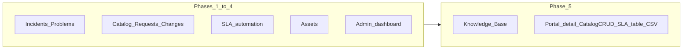

# Requirements Coverage Matrix (Phases 1–4 → Phase 5)

**Purpose:** Map the six confirmed product requirements against what Phases 1–4 already delivered, and what Phase 5 closes.  
Phases **1–4 remain historical** — this document does not rewrite day plans.

**Confirmed requirements**

1. Incident Management  
2. Service Catalog  
3. SLA Management  
4. Asset Management  
5. Knowledge Base  
6. Reports & Dashboards  

---

## Coverage after Phases 1–4

| Requirement | Status | Primary owners | Evidence (high level) | Residual gap → Phase 5 |
|---|---|---|---|---|
| **Incident Management** | **Covered** | Dev A + Dev D | Lifecycle, Impact×Urgency → P1–P4, assign / round-robin, comments + Socket.io, Problems | Portal End User incident **detail** route; ticket ↔ KB article links |
| **Service Catalog** | **Covered** | Dev B + Dev D | Browse catalog, submit requests, approve/reject, fulfillment, Changes | Admin catalog item **CRUD** (today seed + list only) |
| **SLA Management** | **Covered (automation)** | Dev D + Dev A (countdown) + Dev C (charts) | `sla_rules` seed, `sla_due_at`, BullMQ breach + auto-close, Admin SLA charts | Simple Admin **table** editor for `sla_rules` (not drag-drop; PRD drag-drop stays OOS) |
| **Asset Management** | **Covered** | Dev C + Dev D | Admin CRUD, link/unlink ticket, Admin-only `purchaseCost` | Harden only as needed (e.g. `purchase_cost` restored via migration `0008`) |
| **Knowledge Base** | **Missing** | — | Not in original PRD/FRD or codebase | **Full greenfield Phase 5** (categories, articles, search, link to tickets) |
| **Reports & Dashboards** | **Covered (Admin KPIs)** | Dev C + Dev D | `/admin/dashboard` stats + Recharts; custom BI OOS | CSV export of current date-range aggregates; no report builder |

---

## Phase 5 ownership (Days 21–25)

| Dev | Focus | Plan |
|---|---|---|
| **Dev D** | KB schema/API/RBAC; SLA rules Admin API; catalog write APIs; seed; OpenAPI | [Dev D/phase5.md](./Dev%20D/phase5.md) |
| **Dev A** | Ticket ↔ article links; portal incident detail; related articles on incident/problem | [Dev A/phase5.md](./Dev%20A/phase5.md) |
| **Dev B** | End User KB browse/search; Admin catalog CRUD UI; catalog ↔ help articles | [Dev B/phase5.md](./Dev%20B/phase5.md) |
| **Dev C** | Admin KB authoring; SLA rules table UI; dashboard CSV export | [Dev C/phase5.md](./Dev%20C/phase5.md) |

---

## Phase 6 (planned) — Projects & Manager

**KB stays as-is.** New work only: projects / modules / members, `Manager` role, resource-level project ACL, scoped assignment & approvals. Authority: [phase6.md](./phase6.md).

| Addition | Status | Owners |
|----------|--------|--------|
| Project scoping on tickets | In progress / partial | Dev D schema + A/B UI |
| Manager role + ProjectAccessService | Landed (foundation) | Dev D (+ C UI) |
| Project-scoped round-robin | In progress / partial | Dev D + Dev A |
| Manager approvals (alongside Admin) | In progress / partial | Dev D + Dev B |
| Admin User Management (CRUD) | **Open** | Dev D API + Dev C `/admin/users` |

---

## Phase 7 (designed) — EndUser desk

Nav and seed only. Authority: [phase7.md](./phase7.md). Knowledge Base module stays; seed gains five Published articles.

## Still out of scope (unchanged from PRD §4)

- Drag-and-drop SLA policy builder  
- Advanced BI / custom report builders  
- Network asset types / multi-ticket asset history (unless separately requested)  
- Multi-tenant billing, enterprise SSO, native mobile apps  
- Multi-level approval chains; org-chart `users.manager_id`; Manager as ticket-working member  

---

## Related docs

- Track index: [README.md](./README.md)  
- Phase 6: [phase6.md](./phase6.md)  
- Product: [PRD.md](../PRD.md), [FRD.md](../FRD.md)  
