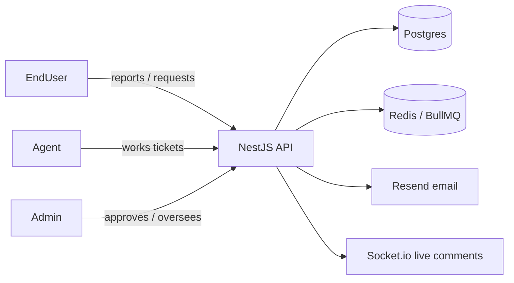
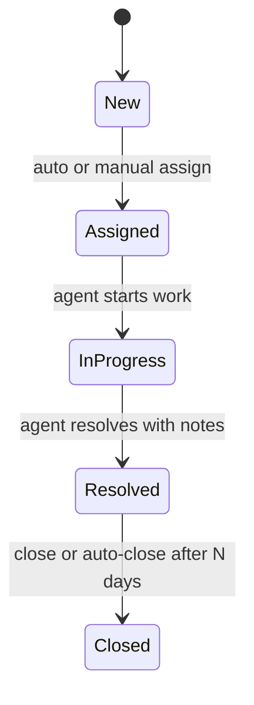
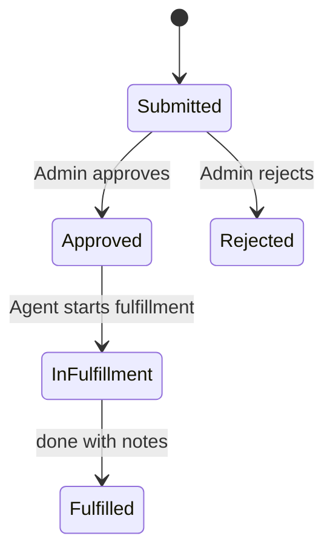
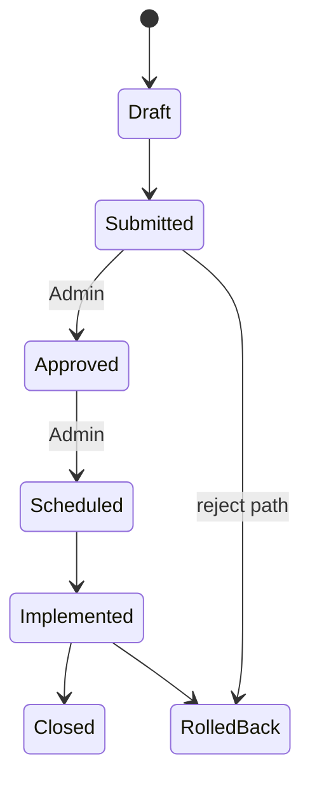

# Sadhox — Overall Workflow (Plain Language)

**Sadhox is an IT helpdesk / ITSM platform.** Employees report problems and request services; agents work the queue; admins approve and oversee. The web app talks only to the NestJS API; Postgres stores data; Redis powers background jobs; Socket.io pushes live comments; Resend sends emails.

## Who uses it

| Role | Person in docs | Main job |
|------|----------------|----------|
| **EndUser** | Eve | Report incidents, browse catalog, submit service requests, track status |
| **Agent** | Alice | Work incident/problem queues, assign, comment, fulfill approved requests, implement changes |
| **Admin** | Ian | Approve requests/changes, manage assets/users, view dashboard & audit |

## Login (everyone)

1. User signs in with email/password.
2. API returns a short-lived **access token**; refresh token sits in an **httpOnly cookie**.
3. Every API call is checked: JWT valid? Role allowed for this route?
4. Important mutations are written to `audit_log`.

---

## Workflow 1 — Incident (something broke)

**Typical path:** EndUser reports → system sets priority + SLA → agent gets assigned → work → resolve → close (or auto-close).

What happens under the hood:

1. Create incident (title, impact, urgency, category).
2. Server computes **priority P1–P4** from Impact × Urgency and sets `sla_due_at`.
3. **Least-loaded / round-robin assignment** can pick an Agent; email “ticket assigned” goes out.
4. Agents move status, add comments; anyone on the ticket detail page sees comments live via room `ticket:{id}`.
5. Agents can **link the incident to a Problem** (shared root cause).
6. Every 5 minutes a BullMQ job flags **SLA breached** if past due; another job auto-closes tickets left in `Resolved` for ~3 days.

**RBAC snapshot:** EndUser creates/views own; Agent/Admin assign and manage queue; EndUser cannot assign or create Problems.

---

## Workflow 2 — Problem (find the root cause)

Problems group recurring incidents:

1. Agent/Admin creates a Problem (root cause, known-error flag).
2. Link one or more Incidents to it.
3. Work the Problem to closure separately from individual incidents.

---

## Workflow 3 — Service Request (I need something)

**Typical path:** Catalog → submit → Admin approve/reject → Agent fulfill.

1. EndUser picks an item from the **Service Catalog** and submits (justification, urgency, form fields).
2. Admin **approves or rejects** (rejection can include a reason); requester gets email.
3. Only after **Approved** can an Agent move to fulfillment and mark **Fulfilled**.

---

## Workflow 4 — Change (planned IT change)

Changes need approval before scheduling (Agent cannot skip straight to Scheduled).

1. Agent/Admin creates a Change (Standard / Normal / Emergency) with schedule + rollback plan.
2. Admin approves, then schedules.
3. Implementation → Closed (or Rolled Back); approval outcomes can trigger email.

---

## Workflow 5 — Assets (inventory)

Admin-owned:

1. CRUD hardware/software assets, assign owners, track status.
2. Link assets to tickets when relevant.
3. Asset owner / link events can trigger notification emails.

---

## What runs in the background (no human click)

| Job | When | Effect |
|-----|------|--------|
| SLA breach check | every ~5 min | **Incidents only.** `slaDueAt` from `sla_rules.resolveMinutes`. Sets `sla_breached`, audit, one breach email. `responseMinutes` is stored, not used for the clock. |
| Auto-close | daily cron | `Resolved` ≥ N days → `Closed` |
| Email queue | on events | assignment, approval outcome, asset notifications via Resend |
| Live comments | on comment create | Socket.io emit to `ticket:{id}` |

---

## One story that ties it together

1. Eve reports “VPN down” → Incident **New**, priority computed, Agent auto-assigned, Alice gets email.
2. Alice comments; Eve sees it live.
3. Same root cause hits many users → Alice opens a **Problem** and links incidents.
4. Eve also requests a laptop from the **catalog** → Admin approves → Agent fulfills.
5. Alice schedules a firewall **Change** → Admin must approve before it can be **Scheduled**.
6. Ian watches volumes/SLA on the Admin dashboard; audit log records the mutations.

---

## Repo map (if you open the code)

- Frontend: [`apps/web`](../apps/web) — React/Vite portals and queues
- API: [`apps/server`](../apps/server) — Nest modules (`incidents`, `problems`, `service-requests`, `changes`, `assets`, `knowledge`, `service-catalog`, `assignment`, `queues`, `mail`, `admin`)
- Schema: [`apps/server/src/database/schema`](../apps/server/src/database/schema)
- Related docs: [STATUS.md](./STATUS.md) (what’s built), [PRD.md](./PRD.md), [FRD.md](./FRD.md), [Architechture.md](./Architechture.md)
