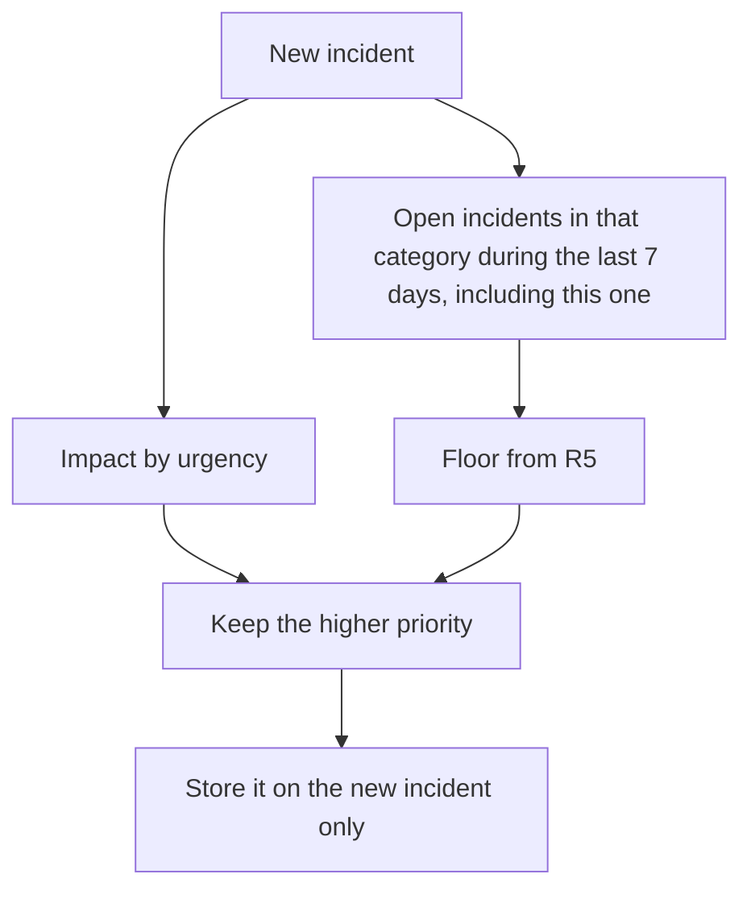

# Client Follow-On - Plan

## Goal Capsule

- **Objective:** Staff can quote the reference shown on a ticket, talk about it in everyday words, see one person's assets for a chosen date range, and have a repeated category raise that ticket's priority. Only an Admin places a project member on a Ticket. Opening a project shows its people and modules, and editing them is one save.
- **Means:** Keep the current priority matrix, SLA tables, asset holder, and project records, and add the display reference, the category floor, the person report, and one project edit (KTD1, KTD2, KTD5).
- **Authority:** Product Contract wins on behavior. Planning Contract wins on mechanism. A unit overrides neither.
- **Execution:** code
- **Stop:** Leave Phase 9's locked rules and files as written. Do not revive phases 10–15. Do not remove the Queues tab. Do not replace UUID primary keys.
- **Finishes:** Dev D lands the server rules first. Dev A, Dev B, and Dev C then land their screens.

---

## Product Contract

### Summary

This follow-on sits after Phase 9 and is split across the four existing developer tracks. Everyday labels replace ITIL names on screen. Tickets and assets gain a readable reference. An Admin can report one person's assets for a date range, and any person can hold an asset. Repeats in one category raise priority. Response times follow a common P1–P4 matrix. A project opens onto its summary, and members and modules are edited in one flow. Only an Admin assigns a project member to a ticket. The Queues tab stays.

### Problem Frame

The client asked for language, numbers, a person-level asset report, repeat-issue priority, a standard response and escalation matrix, a project summary, and an Admin-only project assignment. The product already stores UUID keys, an impact-by-urgency priority, SLA rows per priority, an asset holder, and separate project dialogs. Those pieces do not yet match what the client asked to see.

### Key Decisions

- **Own phase after Phase 9.** Phase 9's locked rules stay written as they are. (session-settled: user-approved — chosen over merging into Phase 9: Phase 9 is a separate designed slice). Governs R10.
- **Everyday labels for every role.** The records underneath keep their stored names. (session-settled: user-approved — chosen over a glossary page only: every role sees the new words). Governs R1.
- **Any person can hold an asset.** (session-settled: user-approved — chosen over copying every asset onto every user: the holder is one chosen person). Governs R4.
- **Same issue means the same category.** (session-settled: user-approved — chosen over matching the title or a linked problem: the count is by category). Governs R5.
- **Queues tab stays.** It is the only in-app place that shows a failed job. (session-settled: user-approved — chosen over dropping the tab by default: drop it only when another in-app view shows failed work). Governs R9.
- **Only an Admin assigns a project member to a ticket.** (session-settled: user-approved — chosen over leaving that action with Agents: the client named Admin as the only actor). Governs R8.

### Requirements

**Language and references**

- R1. Every role sees these on-screen words: Incident as Ticket, Problem as Issue, Service Request as Request, Service Catalog as Catalog, Change as Change request, and SLA as Response time. Stored enum values and role names stay as they are.
- R2. Incidents, problems, service requests, changes, and assets each show their own reference in the form `PREFIX-######` (INC, ISS, REQ, CHG, AST), with a separate counter per prefix. That display reference is the reference number for a service request and for a change. There is no second reference field. Every screen that currently shows that record's sliced id shows this reference instead, including EndUser and portal views and linked records. A sliced project id or module id stays as it is.

**Assets**

- R3. An Admin picks one person and a from/to date and sees every asset that person held at any moment in that inclusive range. A transfer counts for the previous holder and the new holder. An asset with no holder change inside the range still counts for the person who held it through the range.
- R4. The asset holder picker lists every user, and the server accepts any existing user as the holder.

**Priority and response times**

- R5. On incident create, priority is the higher of the impact-by-urgency result and the category floor. The floor counts open incidents in that category created in the last 7 days, including the incident being created: 3–4 is at least P3, 5–9 is at least P2, and 10 or more is at least P1. Closed incidents do not count. Incidents already stored are not rewritten. Requests and changes are not part of this count.
- R6. Where a priority's response minutes are still empty, seed P1 15, P2 60, P3 240, and P4 480. Resolve minutes stay 240, 480, 1440, and 4320. Creating a P1 incident notifies the requester's manager when `reports_to_id` is set, and still saves when it is not. Phase 9's 75% warning and breach recipients stay as specified there.

**Projects, assignment, and queues**

- R7. Opening a project shows its name, manager, members, and modules. One save updates the name, the manager, the members, and the modules.
- R8. Only an Admin can set the assignee on an incident that has a project. Agents and Managers can still assign an incident that has no project. A non-Admin attempt on a project incident is rejected. Problem assignment stays as it is.
- R9. The admin Queues tab remains, with its purpose line and latest failed job.
- R10. Phase 9 files are not edited. This work is a new follow-on under `Docs/Phase`, not a phase numbered 10 through 15.

### Actors

- A1. Admin — runs the person asset report, assigns a project member to a ticket, and edits a project.
- A2. Agent and Manager — use the new words and references, and cannot assign a project ticket.
- A3. EndUser — sees the new words and references on their own tickets, and can be an asset holder.

### Key Flows

- F1. Repeat category
  - **Trigger:** Someone creates an incident in a category that already has open incidents.
  - **Actors:** A2
  - **Steps:** Count open incidents in that category from the last 7 days, including the one being created. Take the higher of that floor and the impact-by-urgency priority. Save it on the new incident only.
  - **Covered by:** R5
- F2. Project edit
  - **Trigger:** An Admin opens a project, then saves changes to its people and modules.
  - **Actors:** A1
  - **Steps:** The summary shows name, manager, members, and modules. One save writes all of those.
  - **Covered by:** R7
- F3. Project assignment
  - **Trigger:** An Agent tries to set the assignee on a project ticket.
  - **Actors:** A2
  - **Steps:** The server rejects the change. An Admin doing the same action succeeds when the person is a project member Agent.
  - **Covered by:** R8

### Acceptance Examples

- AE1. Covers R5. Given 2 open tickets in Email in the last 7 days, when a third is created with Low impact and Low urgency, then its priority is P3.
- AE2. Covers R5. Given no other open ticket in that category, when a ticket is created High impact and High urgency, then its priority is P1.
- AE3. Covers R5. Given 10 open tickets in a category, when another is created, then the new ticket is P1 and the older tickets keep their saved priority.
- AE4. Covers R8. Given a ticket with a project, when an Agent sets the assignee, then the change is rejected. When an Admin sets it to a project member who is an Agent, then it is saved.
- AE5. Covers R3. Given an asset moved from one person to another last month, when an Admin reports the first person for that month, then the asset is listed.
- AE6. Covers R2. Given a new service request and a new change, when each is shown, then each shows its own REQ or CHG reference and no sliced UUID.

### Success Criteria

- A reader can match a ticket on screen to a conversation using the reference alone.
- An Agent cannot place a project member on a ticket, and an Admin can.
- An Admin can answer who held an asset between two dates without exporting the whole register.

### Scope Boundaries

- Knowledge article numbers, a new search box, PDF reports, a report builder, and renaming stored enums or roles.
- Problem assignment rules stay as they are.
- Copying every asset onto every user, and rewriting the priority of tickets that already exist.
- Editing Phase 9, and any file named as phase 10 through phase 15.

#### Deferred to Follow-Up Work

- The project-members screen says any role can be added, while the server accepts only Agents. This follow-on makes the combined edit tell the truth (Agents only). It does not widen membership.

#### Outside this product's identity

- A second help desk, or dropping projects, problems, or the approval chain.

### Sources

- `Docs/Phase/phase9.md` — Phase 9 is designed and not started. Its escalation, desk report, asset holder, and queues rules stay put.
- `apps/server/src/incidents/priority.ts` — priority is impact by urgency. Resolve defaults are already 4h, 8h, 24h, and 72h.
- `apps/server/src/incidents/incident-rbac.ts` — Admin, Agent, and Manager can assign today.
- `apps/web/src/features/admin/admin-layout.tsx` — Queues is an admin nav item. Sentry and the failed-job script are not a screen.
- `apps/web/src/router.tsx` — a project id route redirects back to the list. Edit, Members, and Modules are separate dialogs.
- `apps/server/src/assets/assets.service.ts` — the holder check accepts any existing user. The form lists Agents only.
- Response minutes follow a common P1–P4 table (15 minutes, 1 hour, 4 hours, 8 hours) that matches the resolve times already in `priority.ts`. Published examples: [ITSM Tools priority matrix](https://itsmtools.com/learn/incident-priority-matrix-a-complete-itil-guide-with-examples/) and [Digital Kimya incident guide](https://docs.digitalkimya.net/incident-management/).

---

## Planning Contract

### Key Technical Decisions

- KTD1. Add a display reference column and a per-type counter. Keep the UUID primary key, because comments, links, and foreign keys already use it. Backfill existing rows in creation order inside the same transaction as the counter. Governs R2.
- KTD2. At create, priority is the higher of `calculatePriority` and the category floor in R5. Do not replace the matrix. A bake-off was not needed: both options were concrete, and replacing the matrix would drop behavior the product already ships. (session-settled: user-approved — chosen over matching title or a linked problem: the count is by category). Governs R5.
- KTD3. Enforce R8 in the incident assignment path on the server. Hide the control in the client as well. A ticket with no project keeps today's pool. (session-settled: user-approved — chosen over leaving project assignment with Agents: the client named Admin as the only actor). Governs R8.
- KTD4. Seed response minutes only when that priority's response minutes are empty. Overwriting every row with the published table would discard an Admin edit. Governs R6.
- KTD5. The person report treats holding as an interval. A transfer row counts for both people, and a holder with no change inside the range is still included. The current holder column alone cannot do that. Governs R3.
- KTD6. The single project save still adds only Agents as members, matching `projects.service` today. The screen copy says that. Governs R7.

### High-Level Technical Design

### Assumptions

- The client did not supply the word list. R1 is the default until they correct a word.
- The client did not supply the repeat counts or the 7-day window. R5 is the default.
- The person asset report is an Admin screen. A person does not get a self-serve copy in this follow-on.
- "Standard IT" response times are the empty-row seed in R6. Phase 9's warning and breach rules are not retuned.

### Sequencing

Dev D completes U2, U3, and U4 before the screens that display them. U5, U6, U7, and U8 can then proceed in parallel. U1 can be written at any time and does not block code.

### System-Wide Impact

- Assignment of a project ticket changes who is allowed to write `assignee`. The server check is the boundary. Hiding the control is not.
- The new reference is a second identifier. UUID foreign keys stay. Searches and lists that slice the UUID must switch to the reference or they will show two different numbers.
- The category floor reads recent open incidents when an incident is created, including that new incident. It does not update incidents already stored, and it does not run for requests or changes.
- Asset history becomes user-visible for any holder, including an EndUser. The report stays Admin-only.
- Phase 9's queue, warning, and breach behavior is a neighbor. This follow-on does not change those files.

### Risks

- A backfill that allocates two rows the same reference breaks the number staff will quote. KTD1 keeps allocation in one transaction with the counter, and U2 tests a race.
- Shipping the screen hide in U5 before the server reject in U4 would leave Agents able to assign through the API. U5 depends on U4.
- A P1 create with no manager must still succeed. Notify the manager only when `reports_to_id` is set. Do not fail the create.
- The members dialog currently offers every role while the server accepts only Agents. U8 makes the combined edit say Agents only, so the screen stops promising a save the server rejects.

---

## Implementation Units

### U1. Track notes under Docs/Phase

- **Goal:** Give each developer a short brief for this follow-on without editing Phase 9.
- **Requirements:** R10
- **Dependencies:** none
- **Files:** `Docs/Phase/client-follow-on.md`, `Docs/Phase/Dev A/client-follow-on.md`, `Docs/Phase/Dev B/client-follow-on.md`, `Docs/Phase/Dev C/client-follow-on.md`, `Docs/Phase/Dev D/client-follow-on.md`, `Docs/Phase/README.md`
- **Approach:** The index names the four track files and points here for behavior. Each track file lists that track's U-IDs and file paths and cites R-IDs. It does not restate the rules. README links the index beside Phase 9 and does not number this work 10–15.
- **Test scenarios:**
  - Test expectation: none — these files only point at this plan.
- **Verification:** A developer can open their track file and see which units they own, and Phase 9 files are unchanged.

### U2. Display references

- **Goal:** Persist and return the R2 reference for the five record types, including rows that already exist.
- **Requirements:** R2
- **Dependencies:** none
- **Files:** `apps/server/src/database/schema/index.ts`, a new migration under `apps/server/drizzle/migrations/`, incident, problem, service-request, change, and asset services that create those rows, `apps/server/src/incidents/reference.spec.ts`
- **Approach:**
  1. Add the reference column and a counter per prefix.
  2. Assign the next number inside the create path for each type.
  3. Backfill older rows in creation order so numbers stay stable.
- **Patterns to follow:** UUID primary keys already on those tables. Do not switch the key.
- **Test scenarios:**
  - Creating the first incident returns INC-000001, and the second returns INC-000002.
  - A service request uses REQ and a change uses CHG. Their counters do not share a number.
  - Two creates racing for the same prefix do not receive the same reference.
  - A failed create does not leave a duplicate reference on a later retry.
- **Verification:** The reference spec passes, and existing UUID foreign keys still resolve.

### U3. Category floor and response seed

- **Goal:** Apply R5 when an incident is created, and seed empty response minutes per R6.
- **Requirements:** R5, R6
- **Dependencies:** none
- **Files:** `apps/server/src/incidents/priority.ts`, `apps/server/src/incidents/priority-calculation.service.spec.ts`, the incident create path, the SLA seed path used by `sla_rules`
- **Approach:**
  1. In the same transaction as the insert, count open incidents in the same category created in the last 7 days, including the incident being created (existing open count plus one).
  2. Take the higher of that floor and `calculatePriority`.
  3. Seed response minutes only where the existing value is empty. On P1 create, include the ticket's manager in the existing notify path.
- **Patterns to follow:** `calculatePriority` and `DEFAULT_RESOLVE_MINUTES` in `priority.ts`.
- **Execution note:** Extend the existing priority spec before changing the create path, so the current matrix cases stay pinned.
- **Test scenarios:**
  - AE1. Two open Email tickets plus a new Low/Low ticket save as P3.
  - AE2. A lone High/High ticket stays P1.
  - AE3. The eleventh open ticket in a category is P1, and an older ticket's stored priority is unchanged.
  - A closed ticket in the category does not add to the count.
  - A category with two open tickets and a High/High create stays P1.
  - Seeding does not replace a response-minute value that is already set.
  - Creating a P1 ticket whose requester has no manager still saves the ticket.
  - An unknown category is rejected the same way create rejects it today.
- **Verification:** The priority spec covers AE1–AE3, and resolve defaults are still 240, 480, 1440, and 4320.

### U4. Admin-only project assignment

- **Goal:** Reject a non-Admin assignee change on a project ticket.
- **Requirements:** R8
- **Dependencies:** none
- **Files:** `apps/server/src/incidents/incident-rbac.ts`, `apps/server/src/incidents/incidents.service.ts`, `apps/server/src/incidents/incident-rbac.spec.ts`
- **Approach:** If the incident has a project, only Admin may set `assignedTo`, and that person must still be a project member Agent. Apply that check on create, on update, and on the dedicated assign action. A ticket without a project keeps the current Admin, Agent, and Manager rule.
- **Patterns to follow:** `canAssignIncident` and the project member pool in `assignment.service`.
- **Test scenarios:**
  - AE4. An Agent setting the assignee on a project ticket is rejected, and an Admin setting a project member Agent succeeds.
  - A Manager is rejected on a project ticket the same way an Agent is.
  - An Admin setting someone who is not a project member Agent is rejected.
  - An Agent create, update, or assign that sets `assignedTo` on a project incident is rejected. The same three paths succeed for an Admin setting a project member Agent.
  - An Agent can still set the assignee on a ticket with no project, within today's pool.
- **Verification:** The RBAC spec passes for both the project ticket and the unscoped ticket.

### U5. Ticket and issue screens

- **Goal:** Show R1 words and R2 references on incident and problem screens, and hide project assignment from non-Admins.
- **Requirements:** R1, R2, R8
- **Dependencies:** U2, U4
- **Files:** `apps/web/src/components/layout/app-sidebar.tsx`, `apps/web/src/routes/incidents.tsx`, `apps/web/src/routes/incident-detail.tsx`, `apps/web/src/routes/end-user-incidents.tsx`, `apps/web/src/routes/portal.tsx`, `apps/web/src/routes/portal-incident-detail.tsx`, `apps/web/src/components/incidents/create-incident-dialog.tsx`, `apps/web/src/routes/problems.tsx`, `apps/web/src/routes/problem-detail.tsx`, `apps/web/src/components/incidents/sla-countdown.tsx`, `apps/web/src/components/problems/link-incidents-modal.tsx`, `apps/web/src/components/problems/create-problem-dialog.tsx`
- **Approach:** Replace each incident or problem's sliced id with its display reference, including detail titles, the EndUser list, the portal list and detail, and linked rows. Replace user-visible R1 words across `apps/web`, including admin and manager copy, not only the sidebar. Omit the assign control for Agents and Managers when the incident has a project, and keep the current assignee name visible. The server remains the gate from U4.
- **Patterns to follow:** Phase 7 label renames, which changed copy and not stored values.
- **Test scenarios:**
  - An incident row, its detail title, the EndUser list, and the portal detail show INC-000001 and do not show the first characters of that record's UUID.
  - A linked problem on an incident shows ISS- and not a sliced id.
  - An Agent and a Manager on a project incident have no assignee control. An Admin does. The current assignee name stays visible.
  - The sidebar and the response-time countdown use the R1 words for an EndUser and for an Admin.
- **Verification:** Those three screens match R1 and R2 against a created record from U2.

### U6. Request and change screens

- **Goal:** Show the request and change references and the R1 words on those screens.
- **Requirements:** R1, R2
- **Dependencies:** U2, U5
- **Files:** `apps/web/src/routes/requests.tsx`, `apps/web/src/routes/request-detail.tsx`, `apps/web/src/components/requests/requests-table.tsx`, `apps/web/src/routes/changes.tsx`, `apps/web/src/routes/change-detail.tsx`, `apps/web/src/components/changes/changes-table.tsx`, `apps/web/src/routes/catalog.tsx`, `apps/web/src/components/catalog/catalog-grid.tsx`
- **Approach:** Bind the REQ and CHG references the same way U5 binds INC. Do not add a second reference field. Leave sidebar edits to U5.
- **Patterns to follow:** U5's replacement of the sliced id.
- **Test scenarios:**
  - AE6. A new request shows a REQ reference and a new change shows a CHG reference.
  - The request detail heading uses Request, and the change detail heading uses Change request.
  - A missing reference on an old mocked row renders an empty state rather than a sliced UUID.
- **Verification:** AE6 is visible on both detail screens.

### U7. Asset holder and person report

- **Goal:** Let any person hold an asset, show the AST reference, and give an Admin the dated person report.
- **Requirements:** R2, R3, R4, R9
- **Dependencies:** U2
- **Files:** `apps/web/src/features/assets/asset-form-dialog.tsx`, `apps/web/src/features/assets/asset-register-page.tsx`, `apps/server/src/assets/assets.controller.ts`, `apps/server/src/assets/assets.service.ts`, `apps/server/src/assets/dto/list-assets-query.dto.ts`, `apps/web/src/features/admin/admin-layout.tsx`
- **Approach:**
  1. The holder picker loads every user. Show the AST reference on the register.
  2. The report is a section on the asset register. It takes a person and a from/to date and lists the asset, its AST reference, and the assignment window per KTD5. An empty window shows an empty list. A from date after the to date is a field error.
  3. Leave the Queues nav item in place.
- **Patterns to follow:** `ensureOwner` already accepts any user id.
- **Test scenarios:**
  - An EndUser appears in the holder list and can be saved as the holder.
  - AE5. A holder change last month appears for the previous holder and the new holder. An asset held the whole month with no change appears for that holder. A date range with no rows shows an empty report.
  - A from date after the to date is rejected.
  - A non-Admin calling the person report is rejected.
  - The Queues item is still in the admin nav and still shows the latest failed job when one exists.
- **Verification:** The asset report covers AE5, a non-Admin is rejected, and the Queues route still answers.

### U8. Project summary and single edit

- **Goal:** Opening a project shows its summary, and one save updates name, manager, members, and modules.
- **Requirements:** R7
- **Dependencies:** none
- **Files:** `apps/web/src/features/projects/projects-list-page.tsx`, `apps/web/src/features/projects/project-edit-dialog.tsx`, `apps/web/src/features/projects/project-members-dialog.tsx`, `apps/web/src/features/projects/project-modules-dialog.tsx`, `apps/web/src/router.tsx`, `apps/server/src/projects/projects.service.ts`
- **Approach:** Replace the project-id redirect to the list with the summary. Fold member add and module edit into the existing edit dialog. Member add stays Agent-only per KTD6. Retire the separate Members and Modules entry points once that dialog saves both.
- **Patterns to follow:** `project-edit-dialog.tsx`, `project-members-dialog.tsx`, and `project-modules-dialog.tsx` are the three flows being combined. `getById` today returns the project without members.
- **Test scenarios:**
  - Opening a project shows its name, manager, members, and modules.
  - Saving a new Agent member and a module change persists both.
  - Saving a Manager as a member is rejected, and the edit copy says members are Agents.
  - A project with no members still opens and shows an empty member list.
- **Verification:** The summary shows the member and the module after one save.

---

## Verification Contract

| Check | Command | Applies to |
| --- | --- | --- |
| Reference numbers | `pnpm --filter server exec vitest run src/incidents/reference.spec.ts` | U2 |
| Priority floor | `pnpm --filter server exec vitest run src/incidents/priority-calculation.service.spec.ts` | U3 |
| Assignment gate | `pnpm --filter server exec vitest run src/incidents/incident-rbac.spec.ts` | U4 |
| Asset report | Server spec beside the asset service, plus the register screen | U7 |
| Project summary | Server spec beside the project service, plus the project screen | U8 |
| Labels and references on screen | Signed-in pass for EndUser, Agent, and Admin over ticket, portal, request, change, asset, and project pages, plus admin and manager surfaces that still say SLA | U5, U6, U7, U8 |

---

## Definition of Done

- R1–R10 hold on the running app, and AE1–AE6 have a passing server spec or a checked screen.
- Phase 9 files are untouched. No phase 10–15 file was added.
- The Queues tab is still present.
- Abandoned experiments are not left in the diff.
- U1's track notes cite this plan and do not restate its rules.
