# Schema diagram

Source: `apps/server/src/database/schema/index.ts`. Column detail is in [schema.md](./schema.md).

Solid lines are foreign keys. Dotted lines are correlations with no foreign key: `comments` and `ticket_knowledge_links` point at one ticket table through `ticket_type` + `ticket_id`, and `sla_rules` / `escalation_rules` share `priority_level` with `incidents.priority`.

`assets.linked_ticket_id` and `audit_log.entity_id` are plain uuids with no target table, so they are not drawn.

```mermaid
erDiagram
  users {
    uuid id PK
    varchar email UK
    varchar password_hash
    user_role role
    varchar name
    uuid reports_to_id FK
    timestamptz created_at
    timestamptz updated_at
  }

  refresh_tokens {
    uuid id PK
    uuid user_id FK
    varchar token_hash
    timestamptz expires_at
    boolean revoked
    timestamptz created_at
  }

  projects {
    uuid id PK
    varchar name
    uuid manager_id FK
    timestamptz created_at
  }

  project_members {
    uuid project_id PK, FK
    uuid user_id PK, FK
  }

  modules {
    uuid id PK
    uuid project_id FK
    varchar name
  }

  audit_log {
    uuid id PK
    uuid actor_id FK
    varchar action
    varchar entity_type
    uuid entity_id
    jsonb diff
    timestamptz created_at
  }

  incidents {
    uuid id PK
    varchar title
    text description
    varchar category
    varchar subcategory
    priority_level priority
    impact_urgency impact
    impact_urgency urgency
    incident_status status
    uuid assigned_to FK
    uuid reporter_id FK
    uuid project_id FK
    uuid module_id FK
    timestamptz sla_due_at
    boolean sla_breached
    boolean sla_warned
    text resolution_notes
    timestamptz resolved_at
    timestamptz closed_at
    timestamptz created_at
    timestamptz updated_at
  }

  problems {
    uuid id PK
    varchar title
    text description
    text root_cause
    boolean known_error
    problem_status status
    uuid assigned_to FK
    uuid project_id FK
    uuid module_id FK
    timestamptz created_at
    timestamptz updated_at
  }

  problem_incidents {
    uuid problem_id PK, FK
    uuid incident_id PK, FK, UK
    timestamptz created_at
  }

  service_catalog {
    uuid id PK
    varchar name
    text description
    varchar department
    varchar subcategory
    jsonb form_fields
    boolean is_active
    timestamptz created_at
    timestamptz updated_at
  }

  service_requests {
    uuid id PK
    uuid catalog_id FK
    uuid requester_id FK
    uuid approver_id FK
    varchar title
    text description
    text justification
    request_urgency urgency
    jsonb fields
    request_status status
    uuid assignee_id FK
    timestamptz approved_at
    text rejection_reason
    text fulfillment_notes
    timestamptz fulfilled_at
    uuid project_id FK
    uuid module_id FK
    timestamptz created_at
    timestamptz updated_at
  }

  changes {
    uuid id PK
    varchar title
    text description
    change_type type
    timestamptz scheduled_start
    timestamptz scheduled_end
    text rollback_plan
    change_status status
    uuid created_by FK
    uuid approved_by FK
    timestamptz approved_at
    uuid project_id FK
    uuid module_id FK
    timestamptz created_at
    timestamptz updated_at
  }

  assets {
    uuid id PK
    varchar asset_tag UK
    varchar name
    asset_type type
    uuid owner_id FK
    asset_status status
    numeric purchase_cost
    uuid linked_ticket_id
    varchar serial_number
    varchar location
    timestamptz assigned_at
    timestamptz created_at
    timestamptz updated_at
  }

  asset_assignments {
    uuid id PK
    uuid asset_id FK
    uuid from_owner_id FK
    uuid to_owner_id FK
    uuid assigned_by FK
    varchar note
    timestamptz created_at
  }

  comments {
    uuid id PK
    uuid ticket_id
    ticket_type ticket_type
    uuid author_id FK
    text content
    timestamptz deleted_at
    timestamptz created_at
  }

  sla_rules {
    uuid id PK
    priority_level priority UK
    integer response_minutes
    integer resolve_minutes
    timestamptz created_at
  }

  escalation_rules {
    priority_level priority PK
    boolean notify_manager
    boolean notify_admin
  }

  notifications {
    uuid id PK
    uuid user_id FK
    varchar type
    varchar title
    text body
    varchar href
    timestamptz read_at
    timestamptz created_at
  }

  knowledge_categories {
    uuid id PK
    varchar name
    varchar slug UK
    text description
    timestamptz created_at
    timestamptz updated_at
  }

  knowledge_articles {
    uuid id PK
    varchar title
    varchar slug UK
    text body
    knowledge_article_status status
    uuid category_id FK
    uuid author_id FK
    timestamptz created_at
    timestamptz updated_at
  }

  ticket_knowledge_links {
    uuid id PK
    uuid ticket_id
    ticket_type ticket_type
    uuid article_id FK
    timestamptz created_at
  }

  users |o--o{ users : reports_to_id
  users ||--o{ refresh_tokens : user_id
  users ||--o{ projects : manager_id
  projects ||--o{ project_members : project_id
  users ||--o{ project_members : user_id
  projects ||--o{ modules : project_id
  users |o--o{ audit_log : actor_id
  users ||--o{ incidents : reporter_id
  users |o--o{ incidents : assigned_to
  projects |o--o{ incidents : project_id
  modules |o--o{ incidents : module_id
  users |o--o{ problems : assigned_to
  projects |o--o{ problems : project_id
  modules |o--o{ problems : module_id
  problems ||--o{ problem_incidents : problem_id
  incidents ||--o| problem_incidents : incident_id
  service_catalog ||--o{ service_requests : catalog_id
  users ||--o{ service_requests : requester_id
  users |o--o{ service_requests : approver_id
  users |o--o{ service_requests : assignee_id
  projects |o--o{ service_requests : project_id
  modules |o--o{ service_requests : module_id
  users |o--o{ changes : created_by
  users |o--o{ changes : approved_by
  projects |o--o{ changes : project_id
  modules |o--o{ changes : module_id
  users |o--o{ assets : owner_id
  assets ||--o{ asset_assignments : asset_id
  users |o--o{ asset_assignments : from_owner_id
  users |o--o{ asset_assignments : to_owner_id
  users |o--o{ asset_assignments : assigned_by
  users ||--o{ comments : author_id
  users ||--o{ notifications : user_id
  knowledge_categories ||--o{ knowledge_articles : category_id
  users ||--o{ knowledge_articles : author_id
  knowledge_articles ||--o{ ticket_knowledge_links : article_id
  sla_rules |o..o{ incidents : priority
  escalation_rules |o..o{ incidents : priority
  incidents |o..o{ comments : "ticket_type incident"
  problems |o..o{ comments : "ticket_type problem"
  service_requests |o..o{ comments : "ticket_type service_request"
  changes |o..o{ comments : "ticket_type change"
  incidents |o..o{ ticket_knowledge_links : "ticket_type incident"
  problems |o..o{ ticket_knowledge_links : "ticket_type problem"
  service_requests |o..o{ ticket_knowledge_links : "ticket_type service_request"
  changes |o..o{ ticket_knowledge_links : "ticket_type change"
```

